# \[SAD\]: Solution Architecture Document

**Назначение:** описание целевой архитектуры системы, архитектурных
решений, ограничений, качества и рисков.

**Статус:** `APPROVED`

**Версия:** `0.3`

---

### Table of Contents

- [0. Document Control](#0-document-control)
  - [0.1 Version History](#01-version-history)
- [1. Introduction & Goals](#1-introduction--goals)
  - [1.1 Purpose](#11-purpose)
  - [1.2 Business Problem](#12-business-problem)
    - [Problem Statement](#problem-statement)
    - [Current Situation](#current-situation)
    - [Why Now](#why-now)
    - [Expected Business Outcome](#expected-business-outcome)
  - [1.3 Goals](#13-goals)
    - [Out of Scope](#out-of-scope)
  - [1.4 Requirements Overview](#14-requirements-overview)
    - [1.4.1 Функциональные требования](#141-функциональные-требования)
    - [1.4.2 Нефункциональные / качественные требования](#142-нефункциональные--качественные-требования)
- [2. Architecture Constraints](#2-architecture-constraints)
  - [2.1 Технические ограничения](#21-технические-ограничения)
  - [2.2 Ограничения продукта](#22-ограничения-продукта)
  - [2.3 Ограничения инфраструктуры](#23-ограничения-инфраструктуры)
- [3. Context & Scope](#3-context--scope)
  - [3.1 Business Context for MVP](#31-business-context-for-mvp)
    - [Scope](#scope)
  - [3.2 Technical Context](#32-technical-context)
- [4. Solution Strategy](#4-solution-strategy)
- [5. Building Block View](#5-building-block-view)
  - [5.1 Основная архитектура (Logical View)](#51-основная-архитектура-logical-view)
  - [5.2 Поток данных (Data Flow)](#52-поток-данных-data-flow)
  - [5.3 Аутентификация (Authentication Flow)](#53-аутентификация-authentication-flow)
  - [5.4 Эволюция архитектуры (MVP → BFF/SSR)](#54-эволюция-архитектуры-mvp--bffssr)
  - [5.5 Building Block](#55-building-block)
- [6. Runtime View](#6-runtime-view)
  - [6.1 Search and View Anime](#61-search-and-view-anime)
    - [Runtime Description](#runtime-description)
    - [Architectural Notes](#architectural-notes)
  - [6.2 Application Startup and Persistent State](#62-application-startup-and-persistent-state)
    - [Runtime Description](#runtime-description-1)
    - [Architectural Notes](#architectural-notes-1)
  - [6.3 Authentication and User List Synchronization](#63-authentication-and-user-list-synchronization)
    - [Runtime Description](#runtime-description-2)
    - [Architectural Notes](#architectural-notes-2)
  - [6.4 Error Handling](#64-error-handling)
    - [6.4.1 Local Error Boundary](#641-local-error-boundary)
    - [6.4.2 Global Error Boundary](#642-global-error-boundary)
    - [6.4.3 User Notification](#643-user-notification)
- [7. Deployment View](#7-deployment-view)
  - [7.1 Infrastructure Level 1](#71-infrastructure-level-1)
    - [Motivation](#motivation)
    - [Mapping](#mapping)
- [8. Cross-cutting Concepts](#8-cross-cutting-concepts)
  - [8.1 Data and Provider Contracts](#81-data-and-provider-contracts)
  - [8.2 State and Synchronization](#82-state-and-synchronization)
  - [8.3 Error Handling](#83-error-handling)
- [9. Architecture Decisions](#9-architecture-decisions)
- [10. Quality Requirements](#10-quality-requirements)
- [11. Risks & Technical Debt](#11-risks--technical-debt)
- [12. Glossary](#12-glossary)

---

## 0. Document Control

### 0.1 Version History

| Version       | Date       | Author      | Change                                     | Approval |
| ------------- | ---------- | ----------- | ------------------------------------------ | -------- |
| 0.1           | 10.09.2026 | Minin Maxim | Initial draft                              |          |
| 0.2           | 08.10.2026 | Minin Maxim | Architecture consistency and diagram fixes |          |
| 0.3 (Current) | 08.10.2026 | Minin Maxim | Final architecture consistency corrections | APPROVED |

---

# 1. Introduction & Goals

## 1.1 Purpose

Цель системы — предоставить простой и быстрый аниме-трекер, позволяющий
пользователю находить аниме, просматривать информацию о тайтлах и
управлять собственным списком просмотра.

Архитектура должна обеспечить быстрый пользовательский сценарий,
интеграцию с внешним источником данных и надёжную работу
пользовательских списков.

## 1.2 Business Problem

### Problem Statement

Существующие аниме-трекеры предоставляют перегруженный пользовательский
интерфейс и требуют лишних действий для поиска и добавления аниме в
список.

### Current Situation

Пользователи используют существующие трекеры, часть которых имеет
неудобный мобильный интерфейс и региональные ограничения. Данные для
трекинга предоставляются внешними API.

### Why Now

Необходимо предоставить более простой и быстрый пользовательский
сценарий для MVP с фокусом на поиск аниме и управление личным списком.

### Expected Business Outcome

Сократить количество действий пользователя при переходе к карточке аниме
до 1–2 кликов и обеспечить успешную загрузку данных и синхронизацию
пользовательского списка с внешним источником данных.

## 1.3 Goals

| ID   | Goal                                  | Success Criteria                                                                                                                                                    |
| ---- | ------------------------------------- | ------------------------------------------------------------------------------------------------------------------------------------------------------------------- |
| G-01 | Быстрый доступ к информации об аниме  | Карточка тайтла открывается за 1–2 действия после поиска                                                                                                            |
| G-02 | Удобное ведение личного списка        | Пользователь может добавлять тайтлы и изменять их статус                                                                                                            |
| G-03 | Актуальные данные каталога            | Данные об аниме синхронизируются с внешним источником данных                                                                                                        |
| G-04 | Поддержка русскоязычных пользователей | Основная информация доступна на русском языке                                                                                                                       |
| G-05 | Работа без региональных ограничений   | Каталог и основные функции доступны пользователям независимо от региональных ограничений внешнего источника, насколько это возможно в рамках используемого provider |

### Out of Scope

- Просмотр/стриминг аниме внутри приложения
- Социальные функции и взаимодействие между пользователями
- Сбор аналитики поведения пользователей

## 1.4 Requirements Overview

### 1.4.1 Функциональные требования

| ID    | Требование                                                  | Приоритет | Источник           |
| ----- | ----------------------------------------------------------- | --------- | ------------------ |
| FR-01 | Поиск аниме                                                 | Must      | \[BRD\]: Phase MVP |
| FR-02 | Просмотр карточки аниме                                     | Must      | \[BRD\]: Phase MVP |
| FR-03 | Добавление аниме в личный список                            | Must      | \[BRD\]: Phase MVP |
| FR-04 | Изменение статуса аниме                                     | Must      | \[BRD\]: Phase MVP |
| FR-05 | Просмотр личного списка                                     | Must      | \[BRD\]: Phase MVP |
| FR-06 | Синхронизация пользовательского списка с внешним источником | Must      | \[BRD\]: Phase MVP |
| FR-07 | Фильтрация аниме                                            | Should    | \[BRD\]: Phase MVP |
| FR-08 | Предустановленные категории                                 | Should    | \[BRD\]: Phase MVP |

### 1.4.2 Нефункциональные / качественные требования

| ID     | Требование                         | Целевое значение                                                                      | Приоритет |
| ------ | ---------------------------------- | ------------------------------------------------------------------------------------- | --------- |
| NFR-01 | Основной пользовательский сценарий | Карточка аниме доступна за 1–2 действия                                               | Must      |
| NFR-02 | Доступность каталога               | Успешная загрузка тайтлов                                                             | Must      |
| NFR-03 | Локализация                        | Доступность русскоязычного контента                                                   | Must      |
| NFR-04 | Синхронизация                      | Freshness and revalidation policy is defined by the cache/revalidation strategy.      | Must      |
| NFR-05 | Performance                        | p95 времени получения/отображения данных ≤ 800 ms при наличии данных в client cache   | Must      |
| NFR-06 | Безопасность                       | OAuth-токены не покидают клиентский контекст и не хранятся на собственном сервере MVP | Must      |
| NFR-07 | Privacy                            | Собственный backend и пользовательская база данных отсутствуют в MVP                  | Must      |

---

# 2. Architecture Constraints

## 2.1 Технические ограничения

| ID   | Ограничение                                                                             | Объяснение                                                                                                                                                                      |
| ---- | --------------------------------------------------------------------------------------- | ------------------------------------------------------------------------------------------------------------------------------------------------------------------------------- |
| C-01 | AniList используется как источник данных в MVP                                          | На этапе MVP система интегрируется с AniList. Архитектура должна позволять в дальнейшем подключать другие источники данных без существенной переработки основной части системы. |
| C-02 | Внешний источник данных имеет ограниченные возможности и SLA                            | Полнота каталога, доступность метаданных, ограничения API, rate limits и доступность отдельных функций зависят от выбранного внешнего provider.                                 |
| C-03 | Для синхронизации пользовательского списка в MVP требуется authentication через AniList | На этапе MVP система не предоставляет собственный механизм identity management. Authentication и авторизация доступа к пользовательскому списку делегируются AniList.           |

## 2.2 Ограничения продукта

| ID   | Ограничение                    | Объяснение                                                                         |
| ---- | ------------------------------ | ---------------------------------------------------------------------------------- |
| C-04 | Только персональный трекер     | MVP не включает социальные функции и взаимодействие между пользователями.          |
| C-05 | Без собственного стриминга     | Система не отвечает за просмотр или воспроизведение аниме.                         |
| C-06 | Без пользовательской аналитики | На стороне приложения не предусматривается сбор аналитики поведения пользователей. |

## 2.3 Ограничения инфраструктуры

| ID   | Ограничение                                 | Объяснение                                                                                                            |
| ---- | ------------------------------------------- | --------------------------------------------------------------------------------------------------------------------- |
| C-07 | Бесплатный или минимально затратный хостинг | MVP должен разворачиваться на бесплатной или условно бесплатной инфраструктуре.                                       |
| C-08 | Ограничения статического хостинга           | MVP размещается на static hosting, поэтому архитектура не должна требовать обязательного наличия server-side runtime. |

---

# 3. Context & Scope

## 3.1 Business Context for MVP

Диаграмма показывает высокоуровневый бизнес-контекст системы для MVP и
основные взаимодействия пользователя с Anime Tracker и внешним
поставщиком данных.

```plantuml
@startuml

skinparam backgroundColor white
skinparam shadowing false
skinparam defaultFontName Arial

' Расстояние между крупными блоками
skinparam nodesep 130
skinparam ranksep 60

skinparam package {
    FontColor #1F2937
    FontSize 14
    BorderThickness 2
    RoundCorner 10
    Padding 25
}

skinparam rectangle {
    FontColor #1F2937
    FontSize 14
    BorderThickness 1.5
    RoundCorner 10
}

skinparam actor {
    FontColor #1F2937
    FontSize 14
}

skinparam note {
    BackgroundColor white
    BorderColor #FFFFFF
    FontColor #26364A
    FontSize 13
}

skinparam ArrowColor #26364A
skinparam ArrowThickness 2

' =========================================================
' USER
' =========================================================

package "User" as USER #F2F8FF {

    actor "User\n(Anime fan)" as USER_ACTOR

    rectangle "• Search anime\n• View anime details\n• Manage personal list\n• Authenticate via AniList" as USER_INFO #F2F8FF

    USER_ACTOR -[hidden]down-> USER_INFO
}

' =========================================================
' ANIME TRACKER
' =========================================================

package "Anime Tracker (MVP)" as TRACKER #F7E9FF {

    rectangle "Anime Tracker\n(Client-side Web Application)\nHosted on GitHub Pages\n(Static site)" as TRACKER_MAIN #F7E9FF

    rectangle "• User interface (web)\n• Client-side application logic\n• Provider integration (AniList)\n• Client-side storage (cache)\n• Data transformation (to app model)" as TRACKER_INFO #F7E9FF

    TRACKER_MAIN -[hidden]down-> TRACKER_INFO
}

' =========================================================
' ANILIST API
' =========================================================

package "AniList API" as ANILIST #E9FFF3 {

    rectangle "AniList API\n(External Service)\nProvides anime data\nand user list functionality" as API_MAIN #E9FFF3

    rectangle "• Anime metadata\n• User list data\n  (read/write)\n• Authentication (OAuth 2.0)\n• Other related data\n  (manga, characters, etc.)" as API_INFO #E9FFF3

    API_MAIN -[hidden]down-> API_INFO
}

' =========================================================
' ОСНОВНАЯ СВЯЗЬ USER → TRACKER
' =========================================================

USER --> TRACKER

note on link
Uses via web browser

• Search queries
• View anime details
• Manage personal list
• Authenticate (OAuth)
end note

' =========================================================
' ОСНОВНАЯ СВЯЗЬ TRACKER → API
' =========================================================

TRACKER --> ANILIST

note on link
HTTPS / GraphQL

• Anime metadata
• User list data
• Authentication (OAuth)
• Other data
end note

' =========================================================
' ОБРАТНАЯ СВЯЗЬ TRACKER → USER
' =========================================================

TRACKER ..> USER

note on link
UI with search results,
anime details, list data
end note

' =========================================================
' ОБРАТНАЯ СВЯЗЬ API → TRACKER
' =========================================================

ANILIST ..> TRACKER

note on link
Anime data, user list data,
access tokens
end note

' =========================================================
' ФИКСИРУЕМ ПОРЯДОК
' =========================================================

USER -[hidden]right-> TRACKER
TRACKER -[hidden]right-> ANILIST

@enduml
```

| Participant   | Role                           | Key Data / Interactions                                               |
| ------------- | ------------------------------ | --------------------------------------------------------------------- |
| User          | End user of the system         | Search queries, list management, status changes                       |
| Anime Tracker | Client-side web application    | Provides UI, handles application logic, communicates with AniList API |
| AniList API   | External data provider for MVP | Anime metadata, user list data, authentication (OAuth)                |

### Scope

На этапе MVP система интегрируется с AniList как с единственным внешним
источником данных. Другие data providers, backend services и social
features находятся за пределами MVP.

## 3.2 Technical Context

На этой диаграмме показан предполагаемый технический контекст и основные
компоненты системы. Она отражает целевую архитектуру, в которой
приложение не зависит от конкретного поставщика и может поддерживать
несколько внешних источников данных.

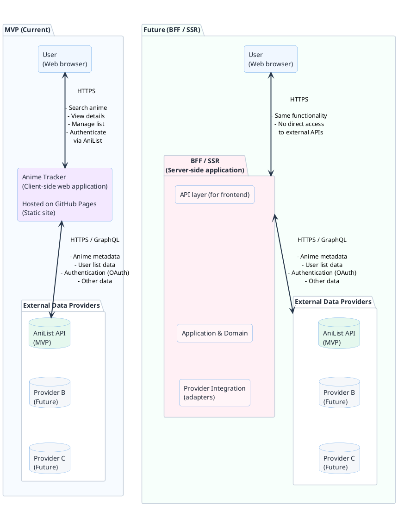

На этапе MVP Anime Tracker работает как client-side application и
напрямую взаимодействует с AniList. Архитектурная граница с external
provider сохраняется независимо от места выполнения provider
integration. В дальнейшем server-side responsibilities могут быть
вынесены за BFF без изменения основных application contracts и domain
model.

---

# 4. Solution Strategy

| Решение                                          | Почему                                                                                                                                                                                                                                                                                                                                                                                                                                          |
| ------------------------------------------------ | ----------------------------------------------------------------------------------------------------------------------------------------------------------------------------------------------------------------------------------------------------------------------------------------------------------------------------------------------------------------------------------------------------------------------------------------------- |
| Client-first architecture                        | Логические границы между presentation, application, domain и infrastructure не должны зависеть от их физического размещения. Это позволяет в дальнейшем перенести server-side responsibilities, включая BFF/SSR, без изменения core domain model и application contracts.                                                                                                                                                                       |
| Provider-agnostic domain model                   | Внутренняя модель системы не зависит от структуры AniList API. Provider-specific данные преобразуются во внутреннюю модель через adapter, что позволяет заменить или добавить источник данных без изменения core domain logic. Взаимодействие application layer с provider integration осуществляется через внутренний контракт приложения, а provider-specific DTO преобразуются adapter-ом.                                                   |
| AniList integration for MVP                      | AniList используется как внешний источник данных на этапе MVP. Интеграция изолируется от основной логики системы, чтобы текущая зависимость от AniList не становилась архитектурной зависимостью всей системы. В MVP AniList является конкретной реализацией внешнего data provider. Authentication и доступ к пользовательскому списку также делегируются AniList. Provider-specific authentication details не должны попадать в domain model. |
| Client-side persistent storage                   | На клиентской стороне через persistence policy сохраняются выбранные категории query state, необходимые для восстановления состояния приложения между сессиями. Runtime Query Cache рассматривается отдельно и используется для временного хранения ранее полученных данных и ускорения отображения.                                                                                                                                            |
| User data synchronization and cache revalidation | Данные, доступные в client-side cache, используются для немедленного отображения пользовательского интерфейса без ожидания сетевого запроса. Одновременно система выполняет revalidation данных с внешним provider и обновляет локальное состояние при обнаружении изменений. Это позволяет сочетать быстрый initial rendering с актуальностью данных и уменьшает зависимость пользовательского сценария от latency внешнего API.               |
| Search and performance optimization              | Использование client-side cache и оптимизация query execution для снижения latency пользовательских сценариев и ограничения количества запросов к внешнему API.                                                                                                                                                                                                                                                                                 |

---

# 5. Building Block View

## 5.1 Основная архитектура (Logical View)

Диаграмма показывает основные строительные блоки системы и их
взаимодействие на уровне логической архитектуры. Размещение компонентов
(клиент или сервер) может меняться в будущем, но границы и контракты
между блоками остаются.

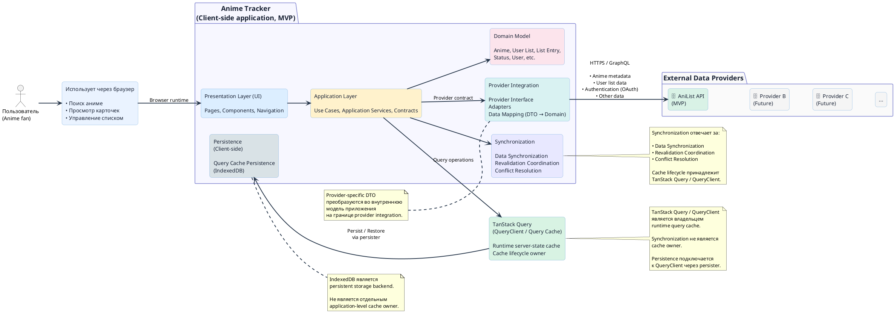

## 5.2 Поток данных (Data Flow)

Диаграмма показывает, как данные загружаются из кэша, отображаются в
приложении и синхронизируются с внешним API.

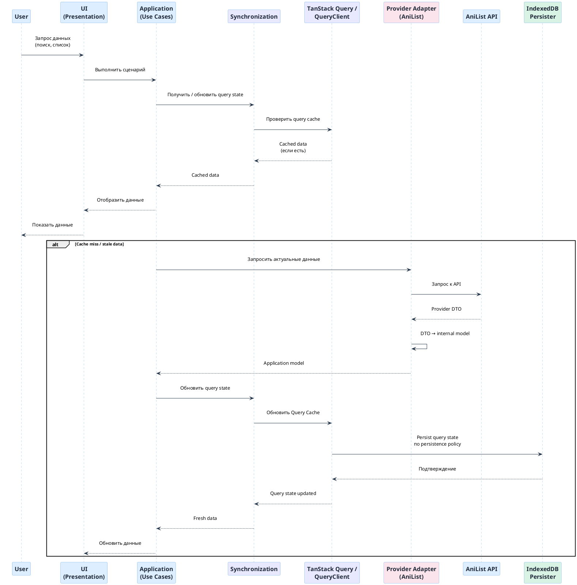

TanStack Query / QueryClient является владельцем lifecycle server-state cache.
IndexedDB используется только как persistent storage через persister и не является вторым application-level cache owner.
Provider Adapter является единственной границей доступа к AniList API.

## 5.3 Аутентификация (Authentication Flow)

На этапе MVP используется OAuth Implicit Grant от AniList.

После успешной авторизации приложение получает access token в browser context.
Access token не сохраняется в persistent query cache и не записывается в
IndexedDB как часть application persistence.

Lifecycle authentication/session state отделён от lifecycle persisted query data.

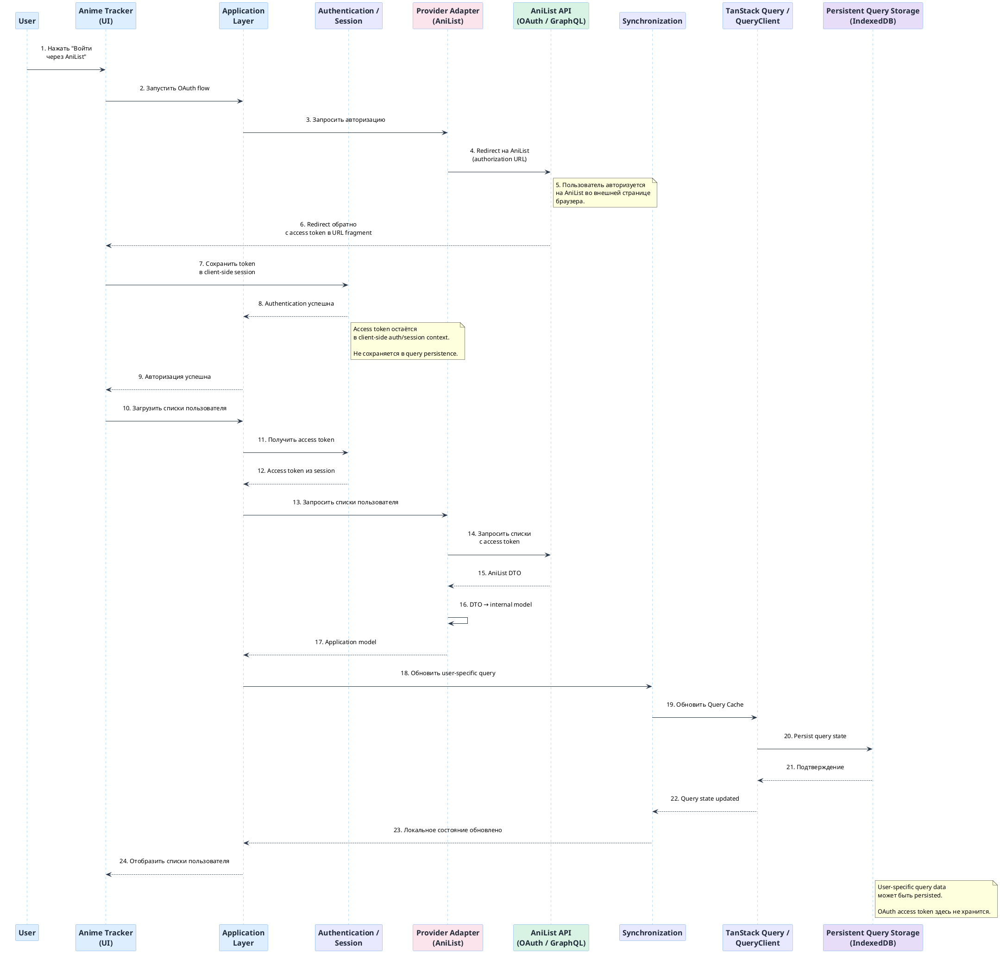

## 5.4 Эволюция архитектуры (MVP → BFF/SSR)

Диаграмма показывает, как текущая клиентская архитектура может быть
эволюционирована в архитектуру с Backend for Frontend (BFF) или SSR без
изменения основных контрактов.

```plantuml
@startuml

skinparam backgroundColor #FFFFFF
skinparam shadowing false
skinparam defaultFontName Arial

skinparam package {
    BorderColor #AAB4C4
    BackgroundColor #FFFFFF
    FontColor #1F2937
    FontSize 14
}

skinparam rectangle {
    FontColor #1F2937
    FontSize 14
    BorderColor #65A5E8
}

skinparam database {
    FontColor #1F2937
    FontSize 14
    BorderColor #65A5E8
}

skinparam ArrowColor #26364A
skinparam ArrowThickness 2


' =========================================================
' MVP — Client-side
' =========================================================

package "MVP (Client-side)" as MVP {

    package "Browser" as MVPBrowser {

        rectangle "UI" as UI #DCEEFF
        rectangle "Application" as App #FFF2CC
        rectangle "Domain" as Domain #FCE4EC

        rectangle "Synchronization" as Sync #E8E8FF
        rectangle "TanStack Query / QueryClient\n(Query Cache)" as QueryCache #D8F3E3
        rectangle "Persistence\n(IndexedDB via Persister)" as Persistence #D8F3E3
        rectangle "Provider Integration\n(AniList Adapter)" as Provider #D8F3F3

        UI -down-> App
        App -down-> Domain

        App -right-> Sync
        App -right-> QueryCache
        App -right-> Provider

        QueryCache -down-> Persistence
    }
}


' =========================================================
' EXTERNAL PROVIDER — MVP
' =========================================================

database "AniList API" as AniList #DCEEFF

Provider --> AniList : HTTPS / GraphQL


' =========================================================
' Эволюция
' =========================================================

rectangle "Эволюция\n(без изменения\nосновных контрактов)" as Evolution #E8EDF3


' =========================================================
' FUTURE — BFF / SSR
' =========================================================

package "Future (BFF / SSR)" as Future {

    package "Browser" as FutureBrowser {

        rectangle "UI\n(SSR / Client)" as FutureUI #DCEEFF
    }

    package "BFF (Server-side)" as BFF {

        rectangle "Application" as FutureApp #FFF2CC
        rectangle "Domain" as FutureDomain #FCE4EC

        rectangle "Synchronization" as FutureSync #E8E8FF
        rectangle "Persistence\n(Server)" as FuturePersistence #D8F3E3
        rectangle "Provider Integration\n(Adapters)" as FutureProvider #D8F3F3

        FutureApp -down-> FutureDomain
        FutureApp -right-> FutureSync
        FutureApp -right-> FutureProvider

        FutureApp -down-> FuturePersistence : Server-side persistence integration
    }

    FutureUI --> FutureApp

    package "External Data Providers" as External {

        database "AniList" as ExternalAniList
        database "Provider B" as ProviderB
        database "Provider C" as ProviderC
    }

    FutureProvider --> ExternalAniList
    FutureProvider --> ProviderB
    FutureProvider --> ProviderC
}

note right of FuturePersistence
Server-side persistence integration.

Persistence remains an infrastructure
concern and is not a Query Cache owner.
end note


' =========================================================
' Только расположение крупных блоков
' =========================================================

MVP -[hidden]right-> Evolution
Evolution -[hidden]right-> Future

@enduml
```

## 5.5 Building Block

Описание основных строительных блоков и их ответственности.

| Building Block          | Ответственность                                                                                                                                                                                                      |
| ----------------------- | -------------------------------------------------------------------------------------------------------------------------------------------------------------------------------------------------------------------- |
| Presentation Layer (UI) | Отображение интерфейса, обработка пользовательских действий, навигация. Не содержит бизнес-логики.                                                                                                                   |
| Application Layer       | Реализация пользовательских сценариев, координация взаимодействия между UI, domain и инфраструктурными блоками. Определяет контракты, которые могут использоваться как на клиенте, так и на сервере (BFF) в будущем. |
| Domain Model            | Основные сущности и бизнес-правила системы (Anime, User List, Status и т. д.). Не зависит от внешних API и механизмов хранения.                                                                                      |
| Persistence             | Сохранение разрешённых persistence policy категорий query state на клиентской стороне (например, IndexedDB). Изолирован от domain model и не владеет runtime Query Cache lifecycle.                                  |
| Synchronization         | Координация синхронизации данных с внешним provider, revalidation и conflict resolution. Не является владельцем query cache lifecycle.                                                                               |
| Provider Integration    | Абстракция и интеграция с внешними поставщиками данных. Преобразование данных из формата провайдера во внутреннюю модель приложения.                                                                                 |
| Authentication          | Работа с механизмами аутентификации внешнего провайдера (OAuth). На этапе MVP используется аутентификация AniList. Изолирована от domain-model.                                                                      |

---

# 6. Runtime View

Runtime View описывает ключевые сценарии выполнения Anime Tracker и
взаимодействие между пользовательским интерфейсом, application layer,
provider integration, client-side storage и внешним API.

Выбраны сценарии, которые наиболее существенно отражают архитектурные
решения MVP:

- получение и отображение данных;
- восстановление локального состояния;
- authentication и синхронизация пользовательских данных;
- обработка ошибок на уровне отдельных компонентов и всего приложения.

## 6.1 Search and View Anime

Сценарий описывает основной пользовательский путь: поиск аниме и
открытие его карточки. Данные внешнего provider не используются напрямую
UI: provider-specific response преобразуется adapter'ом во внутреннюю
модель приложения.

```plantuml
@startuml

skinparam backgroundColor #FFFFFF
skinparam shadowing false
skinparam defaultFontName Arial

skinparam sequence {
    ArrowColor #26364A
    LifeLineBorderColor #72B5E8
    LifeLineBackgroundColor #FFFFFF

    ParticipantBorderColor #65A5E8
    ParticipantBackgroundColor #DCEEFF
    ParticipantFontColor #1F2937
    ParticipantFontSize 15
    ParticipantFontStyle bold

    MessageFontColor #374151
    MessageFontSize 13
    MessageFontName Arial

    ParticipantPadding 25
    BoxPadding 8
    MessagePadding 15
}

participant "User" as User
participant "UI\n(Web App)" as UI
participant "Application\nLayer" as App
participant "Synchronization" as Sync #E8E8FF
participant "TanStack Query\n(QueryClient / Query Cache)" as QueryCache #D8F3E3
database "Persistent Storage\n(IndexedDB)" as Storage #E8DDF8
participant "Provider\nAdapter\n(AniList)" as Adapter #FCE4EC
participant "AniList API\n(GraphQL)" as API #DCEEFF

' =========================================================
' Поиск аниме
' =========================================================

User -> UI : 1. Ввести поисковый запрос

UI -> App : 2. Выполнить поиск

App -> Sync : 3. Получить данные\nчерез query layer

Sync -> QueryCache : 4. Проверить\nquery cache

QueryCache --> Sync : 5. Cached data\n(если доступна)

alt Cached data fresh

    Sync --> App : 6. Вернуть свежие данные
    App --> UI : 7. Вернуть результаты
    UI --> User : 8. Отобразить результаты

else Cache miss / stale data

    Sync --> App : 6a. Cache miss\nили stale data

    Sync -> Adapter : 7a. Выполнить поиск\nчерез provider contract

    Adapter -> API : 8a. Search anime\n(GraphQL request)

    API --> Adapter : 9a. AniList DTO

    Adapter -> Adapter : 10a. DTO →\ninternal application model

    Adapter --> Sync : 11a. Результаты\nв application model

    Sync -> QueryCache : 12a. Обновить query state

    QueryCache --> Sync : 13a. Cache updated

    Sync --> App : 14a. Query updated

    App --> UI : 16a. Вернуть результаты

    UI --> User : 17a. Отобразить результаты

end

' =========================================================
' Открытие аниме
' =========================================================

User -> UI : 20. Открыть аниме

UI -> App : 21. Получить детали аниме

App -> Sync : 22. Получить cached details

Sync -> QueryCache : 23. Проверить\nquery cache

QueryCache --> Sync : 24. Cached details\n(если доступны)

alt Данные в query cache доступны

    Sync --> App : 25. Вернуть cached details

    App --> UI : 26. Немедленно\nотобразить детали

    par Background revalidation

        Sync -> Adapter : 27. Revalidate details

        Adapter -> API : 28. Получить детали\n(GraphQL request)

        API --> Adapter : 29. AniList DTO

        Adapter -> Adapter : 30. DTO →\ninternal application model

        Adapter --> Sync : 31. Fresh application model

        Sync -> QueryCache : 32. Обновить\nQuery Cache

        QueryCache -> Storage : 34. Persist\nupdated query state

        Storage --> QueryCache : 35. Persistence complete

    end

else Данных в query cache нет

    Sync -> Adapter : 27a. Получить детали\nчерез provider contract

    Adapter -> API : 28a. Get anime details\n(GraphQL request)

    API --> Adapter : 29a. AniList DTO

    Adapter -> Adapter : 30a. DTO →\ninternal application model

    Adapter --> Sync : 31a. Anime details

    Sync -> QueryCache : 32a. Сохранить\ndetails в Query Cache

    QueryCache -> Storage : 34a. Persist\nquery state

    Storage --> QueryCache : 35a. Persistence complete

    QueryCache --> Sync : 36a. Cache updated

    Sync --> App : 37a. Query updated

    App --> UI : 38a. Отобразить детали

end

' =========================================================
' Архитектурные границы
' =========================================================

note right of QueryCache
TanStack Query / QueryClient
является владельцем
runtime query cache.

Query Cache используется
для быстрого доступа
к данным в памяти.

IndexedDB используется только
как persistence backend.

Search results не persist-ятся
по умолчанию.
end note

note right of Storage
IndexedDB не является
отдельным application-level cache.

OAuth access token
не сохраняется здесь
через query persistence.
end note

note left of Adapter
Provider-specific DTO
преобразуются во внутреннюю
модель приложения
на границе provider integration.
end note

@enduml
```

### Runtime Description

1. Пользователь вводит поисковый запрос или открывает карточку аниме.
2. UI передаёт действие в application layer.
3. Application layer использует synchronization/query-cache layer для проверки ранее загруженных данных.
4. Если данные отсутствуют или требуют revalidation, application layer передаёт операцию synchronization layer, который обращается к provider adapter через внутренний application contract.
5. Provider adapter выполняет запрос к AniList API.
6. Полученный provider-specific DTO преобразуется adapter-ом во внутреннюю модель приложения.
7. Synchronization layer передаёт результат в QueryClient для обновления query cache; persistence выполняется QueryClient через persister только для query categories, разрешённых persistence policy.
8. UI получает данные в application model и отображает их пользователю.
9. Если данные были восстановлены из cache, они могут быть отображены немедленно, а revalidation выполняется отдельно в соответствии с cache/revalidation strategy.

### Architectural Notes

Ключевой момент сценария — **UI и application layer не зависят от
структуры AniList API**. Замена provider должна затрагивать прежде всего
соответствующий adapter, а не domain/application model.

## 6.2 Application Startup and Persistent State

Сценарий описывает запуск приложения, восстановление сохранённого
пользовательского состояния и последующую проверку актуальности данных
через внешний provider.

Локально сохранённое состояние используется для того, чтобы приложение
могло отобразить ранее загруженные данные без ожидания сетевого запроса.

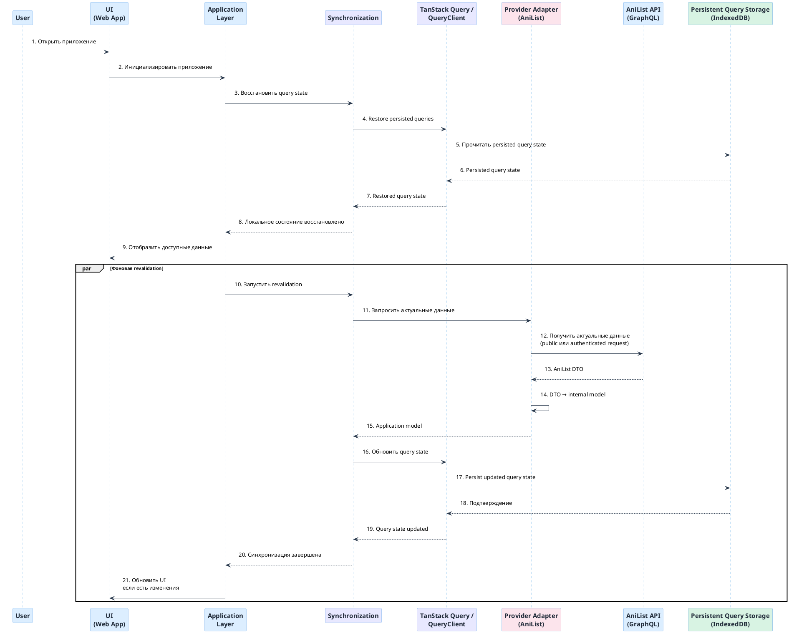

### Runtime Description

1.  Пользователь открывает приложение.
2.  Application layer инициирует восстановление persisted query state через synchronization/query layer. QueryClient восстанавливает persisted queries через IndexedDB persister. Authentication/session state не является частью persisted query cache и через него не восстанавливается.
3.  Если для последующих authenticated operations отсутствует действующий client-side access token, пользователю потребуется повторная authentication через AniList.
4.  Восстановленное состояние передаётся UI.
5.  UI отображает доступные локальные данные без обязательного ожидания
    сетевого запроса.
6.  После восстановления состояния приложение выполняет revalidation с
    внешним provider. Public queries revalidate независимо от authentication;
    user-specific queries — только при наличии действующей
    authentication/session.
7.  Полученные данные преобразуются adapter'ом во внутреннюю модель
    приложения.
8.  Synchronization layer сравнивает актуальные данные с локальным
    состоянием и координирует обновление query state.
9.  При наличии изменений QueryClient обновляет локальное состояние.
10. UI получает обновлённое состояние.

### Architectural Notes

Persistent storage и cache имеют разные назначения:

- **Query Cache** — runtime server-state cache;
- **Persistent Storage** — storage backend для persisted query state;
- **Revalidation** — проверка актуальности данных у provider.

Таким образом, локальные данные используются для быстрого initial
rendering, но не рассматриваются как окончательный источник истины для
данных, которые синхронизируются с external provider.

## 6.3 Authentication and User List Synchronization

Сценарий описывает authentication и последующую синхронизацию
пользовательского списка с AniList.

На этапе MVP authentication предоставляется внешним provider.
Application layer не содержит provider-specific authentication logic в
domain model.

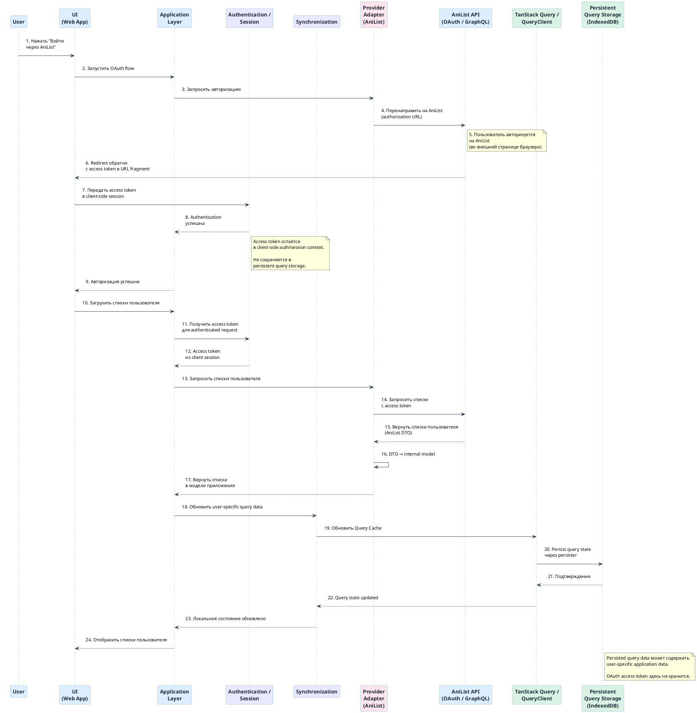

### Runtime Description

1. Пользователь инициирует authentication через UI.
2. Application layer инициирует authentication flow через provider integration.
3. AniList выполняет аутентификацию пользователя.
4. После успешной authentication access token остаётся в client-side auth/session context.
5. Access token не сохраняется в persistent query storage.
6. Application layer запрашивает пользовательский список через provider adapter.
7. Adapter выполняет authenticated request к AniList API.
8. Provider-specific данные преобразуются во внутреннюю модель приложения.
9. Application layer передаёт user-specific query data в synchronization/persistence flow.
10. Persisted query data сохраняется в IndexedDB; OAuth access token в persistence не попадает.
11. UI отображает пользовательский список.

### Architectural Notes

Authentication является частью provider integration и не должна
становиться зависимостью domain model от AniList.

Это позволяет в будущем изменить способ authentication вместе с provider
integration, не меняя основную модель приложения.

## 6.4 Error Handling

### 6.4.1 Local Error Boundary

Используется для ошибки, которую можно локализовать в конкретной части
UI. Ошибка не должна приводить к отказу всего приложения.

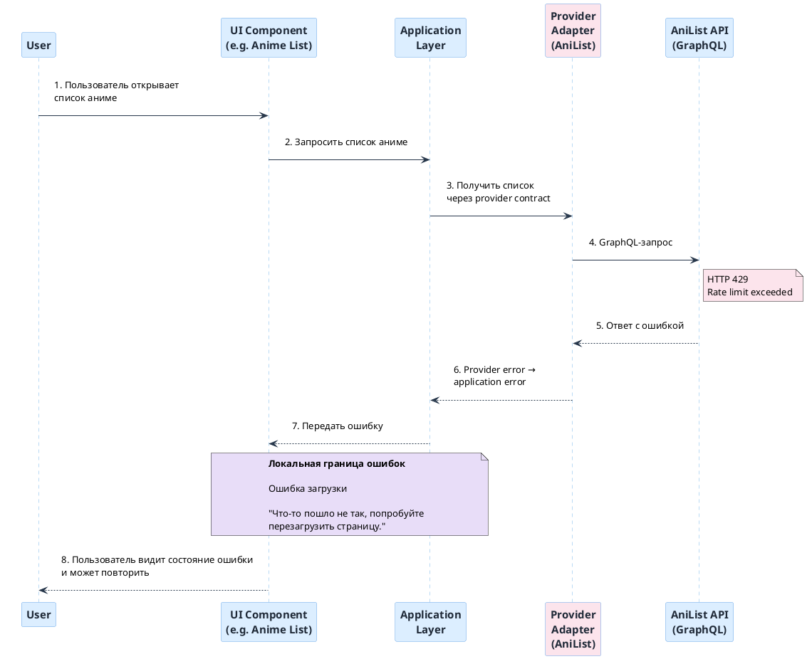

### Runtime Description

1.  UI component выполняет свой сценарий.
2.  Во время выполнения возникает ошибка.
3.  Ошибка перехватывается ближайшим Error Boundary.
4.  Вместо неисправного компонента отображается локальное error state.
5.  Остальная часть приложения продолжает работу.

### 6.4.2 Global Error Boundary

Используется, если ошибка не может быть обработана локальным Error
Boundary или происходит на уровне, затрагивающем всё приложение.

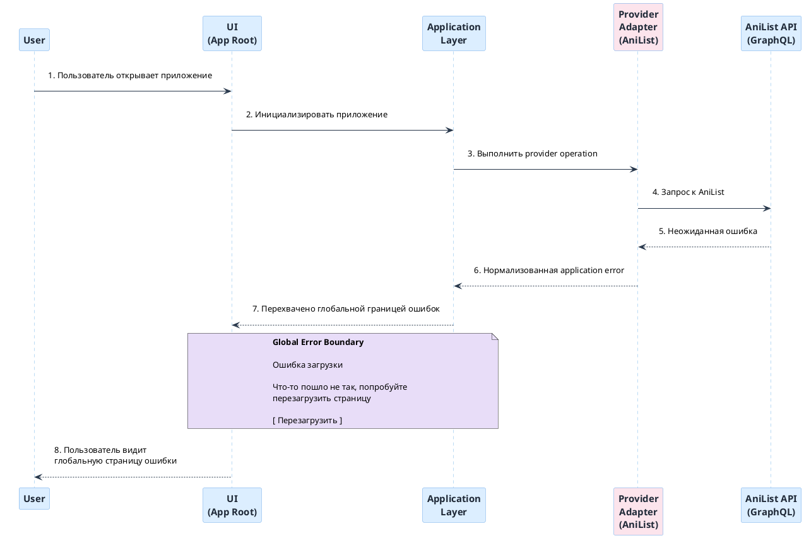

### Runtime Description

1.  Ошибка возникает во время выполнения приложения.
2.  Если ошибка не может быть обработана локальным Error Boundary, она
    передаётся на глобальный уровень.
3.  Global Error Boundary перехватывает ошибку.
4.  Пользователю отображается общий error state.
5.  Пользователь может повторить загрузку или вернуться к предыдущему
    состоянию.

### 6.4.3 User Notification

Не каждая ошибка должна приводить к замене текущего UI error state. Для
операций, которые выполняются поверх уже отображаемого интерфейса,
результат может сообщаться через notification.

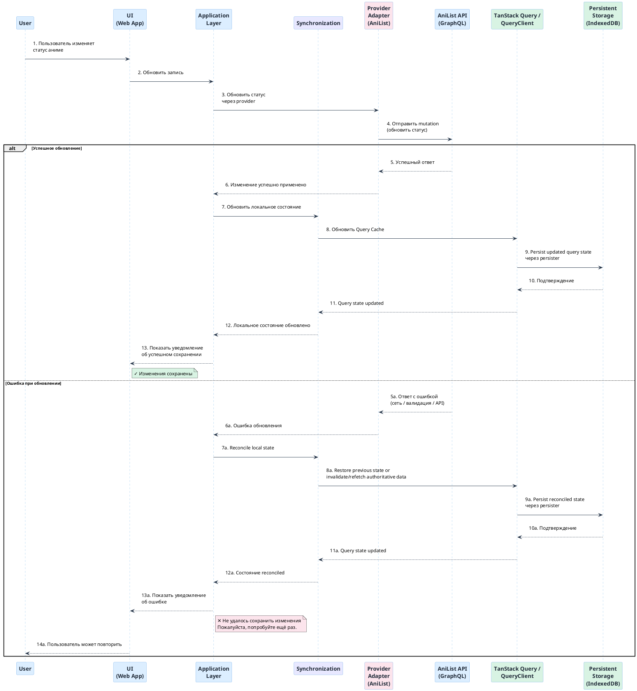

### Runtime Description

1.  Пользователь выполняет действие, например изменяет состояние аниме.
2.  UI передаёт действие в application layer.
3.  Application layer выполняет необходимую операцию через provider
    adapter.
4.  Adapter взаимодействует с внешним API.
5.  Результат операции передаётся обратно application layer.
6.  При успешном выполнении UI получает обновлённое состояние и success
    notification по необходимости.
7.  При ошибке текущий UI сохраняется, а пользователь получает error
    notification.
8.  При ошибке mutation локальное состояние не должно оставаться в
    несогласованном виде: приложение восстанавливает предыдущее состояние
    либо инвалидирует и повторно получает authoritative state, после чего
    сохраняет только reconciled query state.

---

# 7. Deployment View

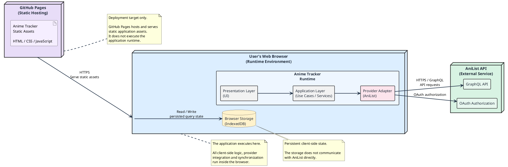

## 7.1 Infrastructure Level 1

MVP разворачивается как статическое web-приложение. Клиентские артефакты
публикуются через GitHub Pages или аналогичный static hosting и
загружаются пользователем в web browser.

Собственного application server или server-side backend в MVP нет.
Внешнее взаимодействие с данными и пользовательской аутентификацией
выполняется непосредственно из web application через AniList API.

Persisted query state хранится в browser storage. Это позволяет
восстановить ранее сохранённые данные между сессиями и отображать их до
завершения повторной синхронизации с AniList. Runtime Query Cache при этом
остаётся в памяти приложения и управляется TanStack Query / QueryClient.

### Motivation

Такой deployment соответствует ограничениям MVP: отсутствует
необходимость поддерживать собственную серверную инфраструктуру, backend
или database server. Приложение может быть размещено на бесплатном
static hosting, а основная runtime-логика выполняется на стороне
клиента.

### Mapping

| Software artifact               | Infrastructure element                 |
| ------------------------------- | -------------------------------------- |
| Anime Tracker Web Application   | GitHub Pages / Static Hosting          |
| UI / Application / Domain logic | Browser                                |
| Client-side query persistence   | IndexedDB via TanStack Query Persister |
| AniList Adapter                 | Browser runtime                        |
| AniList integration             | AniList API                            |
| Authentication flow             | AniList OAuth / AniList API            |

---

# 8. Cross-cutting Concepts

## 8.1 Data and Provider Contracts

Система использует внутренний контракт данных, независимый от формата конкретного внешнего источника.

Данные внешнего источника преобразуются в application model на границе интеграции. Остальная часть приложения работает только с внутренней моделью и не зависит от provider-specific DTO.

Это позволяет в дальнейшем заменить или добавить внешний источник данных без изменения основной логики приложения.

## 8.2 State and Synchronization

Пользовательское состояние и ранее загруженные данные могут сохраняться на клиентской стороне между сессиями.

При запуске приложения сохранённое состояние используется для быстрого initial rendering. После этого выполняется синхронизация с внешним источником для проверки актуальности данных.

Таким образом, локальное состояние обеспечивает быстрый интерфейс, а внешний источник остаётся источником актуальных данных.

## 8.3 Error Handling

Ошибки обрабатываются на уровне отдельных UI-сегментов и интеграций, чтобы сбой одной части приложения не приводил к потере всего пользовательского сценария.

Ошибки внешних источников преобразуются в контролируемое состояние приложения и отображаются пользователю через соответствующий UI или notification.

---

# 9. Architecture Decisions

| ID      | Decision                                                  | Status   | Date       | ADR                                                                                            |
| ------- | --------------------------------------------------------- | -------- | ---------- | ---------------------------------------------------------------------------------------------- |
| ADR-001 | Client-Side Architecture for MVP                          | Accepted | 2026-10-05 | [ADR-001](./ARD's/[ADR-001]%20-%20Client-Side%20Architecture%20for%20MVP.md)                   |
| ADR-002 | Provider-agnostic application model                       | Accepted | 2026-10-06 | [ADR-002](./ARD's/[ADR-002]%20-%20Provider-agnostic-application-model.md)                      |
| ADR-003 | AniList as the MVP data provider                          | Accepted | 2026-10-06 | [ADR-003](./ARD's/[ADR-003]%20-%20Anilist-as-the-mvp-data-provider.md)                         |
| ADR-004 | Server-State Cache, Persistence and Revalidation Strategy | Accepted | 2026-10-06 | [ADR-004](./ARD's/[ADR-004]%20-%20Server-State-Cache-Persistence-and-Revalidation-Strategy.md) |
| ADR-005 | Client-side Persistent storage                            | Accepted | 2026-10-06 | [ADR-005](./ARD's/[ADR-005]%20-%20Client-Side-Persistent-Storage.md)                           |

# 10. Quality Requirements

| Quality Attribute | Requirement                                               | Verification                       |
| ----------------- | --------------------------------------------------------- | ---------------------------------- |
| Performance       | Cached critical data displayed within target ≤ 800 ms p95 | Manual performance verification    |
| Usability         | Основные действия выполняются за 1–2 действия             | Manual acceptance verification     |
| Data Freshness    | Stale cached data отображается до background revalidation | Manual functional verification     |
| Reliability       | Ошибка AniList не приводит к падению всего приложения     | Manual error scenario verification |
| Security          | OAuth token остаётся в client context                     | Architecture / network inspection  |
| Maintainability   | Provider-specific DTO изолированы adapter boundary        | Code review                        |
| Evolvability      | BFF/SSR migration не требует изменения domain contracts   | Architecture review                |

# 11. Risks & Technical Debt

| Priority | Type             | Risk / Technical Debt                                   | Impact                                                                              | Mitigation                                                                                                           |
| -------- | ---------------- | ------------------------------------------------------- | ----------------------------------------------------------------------------------- | -------------------------------------------------------------------------------------------------------------------- |
| High     | Risk             | Зависимость от AniList как единственного MVP-провайдера | Недоступность или ограничения AniList напрямую влияют на работу приложения          | Использование cache, revalidation и изоляция provider integration                                                    |
| High     | Risk             | OAuth token хранится в browser context                  | Компрометация client environment может привести к раскрытию token                   | Не передавать token на собственный backend; пересмотреть архитектуру при появлении server-side security requirements |
| Medium   | Limitation       | Отсутствие собственного backend                         | Невозможно централизованно контролировать API requests, secrets и server-side logic | Сохранение application/domain boundaries для возможного BFF/SSR                                                      |
| Medium   | Risk             | Persisted query cache может расти                       | Накопление данных может привести к увеличению browser storage usage                 | Ограниченная persistence policy и retention                                                                          |
| Medium   | Risk             | Зависимость от AniList rate limits                      | Большое количество запросов может привести к throttling                             | TanStack Query cache, controlled revalidation и prefetching                                                          |
| Low      | Limitation       | Offline mode отсутствует в MVP                          | При отсутствии сети новые данные недоступны                                         | Persistence architecture оставляет основу для добавления offline mode после MVP                                      |
| Low      | Future Evolution | Возможный переход к BFF/SSR в будущем                   | Потребуется изменение runtime architecture                                          | Provider adapter и application/domain boundaries позволяют ограничить влияние изменения                              |

# 12. Glossary

No separate glossary is required for the MVP.

The project is maintained by a single Owner/Developer, and the terminology used in this document is considered sufficiently clear from the surrounding architectural context and referenced ADRs.
